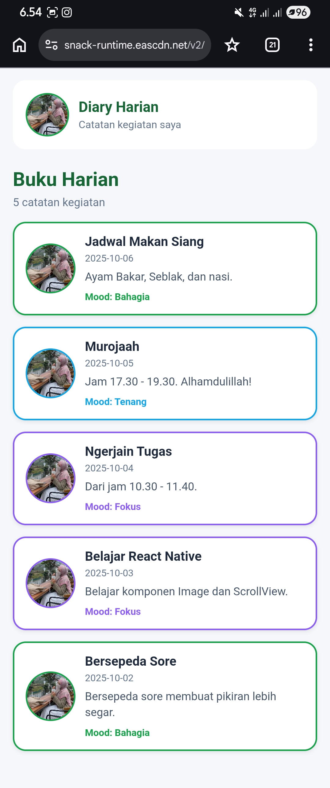
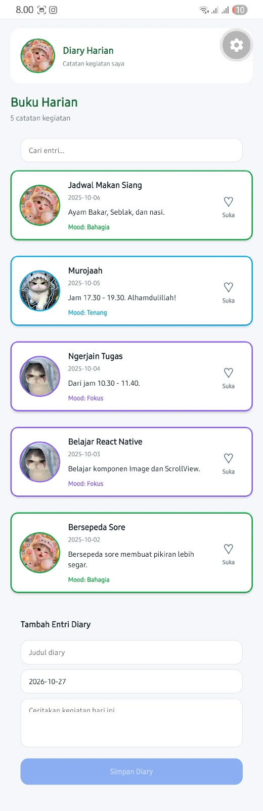

# Diary App

Aplikasi buku harian sederhana yang dibuat dengan **React Native + Expo** untuk tugas praktikum Mobile Programming (Pertemuan 2).

Nama : M. Abdullah Harun Musa F 
NIM  : 2430511074 
Kelas : 5B


## Cara Menjalankan Proyek

1. Pastikan Node.js sudah terpasang.
2. Clone atau ekstrak proyek, lalu masuk ke foldernya:
   ```bash
   cd Diary-App-M.Abdullah-main
   ```
3. Pasang dependensi:
   ```bash
   npm install
   ```
4. Jalankan proyek:
   ```bash
   npx expo start
   ```
5. Scan QR code dengan aplikasi **Expo Go** di HP, atau tekan `a` untuk membuka emulator Android.

> Jika jaringan bermasalah, gunakan `npx expo start --tunnel`.

## Fitur yang Diselesaikan

- [x] Menampilkan **5 entri diary** (judul, tanggal, pratinjau, dan mood).
- [x] **Gambar lokal** dari folder `assets/moods` (tidak lagi memakai gambar remote).
- [x] **Avatar pengguna** pada header menggunakan komponen `Image`.
- [x] **Variasi tampilan kartu berdasarkan mood**: warna border dan label mood berbeda untuk Bahagia (hijau), Tenang (biru), dan Fokus (ungu).
- [x] **Reusable component**: `DiaryCard` dipisahkan ke folder `components` dan dipakai ulang untuk setiap entri.
- [x] Penggunaan komponen dasar: `View`, `Text`, `Image`, `ScrollView`, props, dan `StyleSheet`.

## Struktur Folder

```
Diary-App-M.Abdullah-main/
├── App.js
├── index.js
├── app.json
├── package.json
├── assets/
│   └── moods/
│       └── happy.png
└── src/
    ├── components/
    │   └── DiaryCard.js
    └── screens/
        └── DiaryListScreen.js
```

## Screenshot

Tampilan aplikasi di Expo Go / emulator:



<!-- Letakkan screenshot di folder screenshots/ dengan nama screenshot.png -->

## Teknologi

- React Native
- Expo
- react-native-safe-area-context


# Diary App — React Native Expo

Aplikasi Diary App merupakan proyek praktikum mata kuliah **Mobile Programming** menggunakan React Native dan Expo CLI. Proyek ini dikembangkan secara bertahap dari Pertemuan 2, Pertemuan 3, hingga Pertemuan 4.

## Teknologi yang Digunakan

- React Native
- Expo CLI
- JavaScript
- React Hooks (`useState` dan `useMemo`)
- Flexbox dan StyleSheet
- FlatList
- React Native Safe Area Context

## Fitur Aplikasi

### Pertemuan 2 — Pengenalan React Native dan Komponen Dasar

- Menampilkan daftar catatan diary.
- Menggunakan komponen dasar `View`, `Text`, dan `Image`.
- Membuat komponen `DiaryCard` yang dapat digunakan kembali.
- Menggunakan gambar mood lokal dari folder `assets/moods`.
- Menampilkan beberapa entri diary dengan variasi tampilan berdasarkan mood.

### Pertemuan 3 — Desain UI dan Layout Responsif

- Mengatur tampilan menggunakan Flexbox dan StyleSheet.
- Menggunakan design tokens untuk warna, spacing, radius, dan tipografi.
- Menampilkan daftar diary menggunakan `FlatList`.
- Mendukung layout responsif satu kolom pada layar ponsel dan dua kolom ketika lebar layar mencapai 600 piksel.
- Menambahkan `DiaryDetailModal` untuk menampilkan detail catatan.
- Menerapkan aksesibilitas dasar pada komponen interaktif.

**Penjelasan breakpoint 600 px:** aplikasi menggunakan `useWindowDimensions()` untuk membaca lebar layar. Jika lebar layar kurang dari 600 px, daftar menggunakan satu kolom. Jika lebar layar mencapai atau melebihi 600 px, daftar menggunakan dua kolom.

### Pertemuan 4 — Props dan State

- Mengirim data dan callback ke `DiaryCard` melalui props.
- Menggunakan `SearchBar` untuk mencari catatan berdasarkan judul, ringkasan, dan tanggal.
- Menggunakan `useState` untuk mengelola data diary, pencarian, status like, dan catatan yang dipilih.
- Menambahkan serta menghapus status like tanpa memuat ulang aplikasi.
- Menggunakan `EntryForm` untuk menambahkan entri diary baru.
- Menggunakan controlled inputs untuk mengelola isian formulir.
- Membuka dan menutup modal detail berdasarkan entri yang dipilih.

## Struktur Folder

```text
Diary-App-M.Abdullah/
├── App.js
├── app.json
├── package.json
├── assets/
│   └── moods/
│       ├── happy.png
│       ├── calm.png
│       ├── focus.png
│       └── default.png
└── src/
    ├── components/
    │   ├── DiaryCard.js
    │   ├── DiaryDetailModal.js
    │   ├── EntryForm.js
    │   └── SearchBar.js
    ├── screens/
    │   └── DiaryListScreen.js
    └── styles/
        └── tokens.js
```

## Cara Menjalankan Aplikasi

1. Pastikan Node.js sudah terpasang.
2. Buka folder proyek melalui terminal.
3. Instal dependensi:

   ```bash
   npm install
   ```

4. Jalankan aplikasi:

   ```bash
   npx expo start
   ```

5. Buka aplikasi melalui Expo Go atau Android Emulator yang kompatibel dengan versi Expo SDK proyek.

## Pengujian

Pengujian aplikasi dilakukan dengan memeriksa:

- Tampilan daftar diary pada layar satu kolom dan dua kolom.
- Fungsi pencarian catatan.
- Perubahan status like.
- Pembukaan dan penutupan modal detail.
- Penambahan entri melalui formulir.
- Perubahan tampilan setelah state diperbarui.

## Screenshot

Tampilan aplikasi di Expo Go / emulator:



